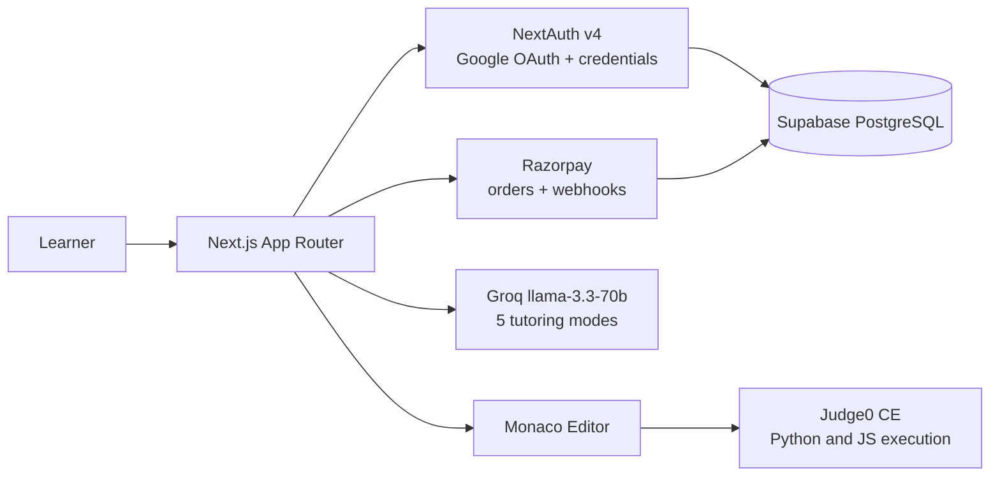

[README (1).md](https://github.com/user-attachments/files/33547303/README.1.md)

# Yusuf Khambaty

**I build backends that run businesses, and AI products people actually pay for.**

Full-Stack Engineer · Node.js · Next.js · TypeScript · LLM Integration

---

## At a glance

I'm a developer based in Mumbai with 1+ year of production experience. By day I run backend and technical operations for an e-commerce business; on my own time I ship full-stack products end to end: auth, payments, AI, deployment.

> I like problems where code has to move a real number: hours saved, revenue gained, errors removed.

## Impact in numbers

| Metric | Result | Where |
|:--|:--|:--|
| Listing time per product | **45 min → 8 min** (82% faster) | Automated pipeline, 150+ SKUs |
| Organic search visibility | **+35%** in 3 months | SEO engine on Google Search Console API |
| Revenue | **+40%** over 6 months | KPI dashboard tracking 12+ metrics |
| Marketplace listing health | **65% → 92%** | Automated data-quality monitoring |
| Manual order/inventory errors | **~30% fewer** | Amazon + Flipkart API integration |
| Content reach | **+50%** | Social media automation |

## Flagship: TutorAI

A LeetCode-style DSA practice platform with an AI tutor that **guides your thinking but never hands you the answer.**

[**Try it live →**](https://tutor-ai-stack.vercel.app) · [Source](https://github.com/yukyk/TutorAIStack)

- **Code execution:** Monaco editor, 15 DSA problems, test-case runners for Python and JavaScript via Judge0.
- **AI tutor:** layered prompt design (foundation + Hint, Logic, Humanize, Debug, Optimize modes) so the model teaches instead of solving.
- **Monetisation:** credit system gating AI use, Razorpay checkout with verified webhooks, billing dashboard.
- **Ops:** admin dashboard with live online users, waitlist and analytics; deployed on Vercel with CI/CD from GitHub.

## Other builds

<table>
<tr>
<td width="50%" valign="top">

### Advanced Expense Tracker
`Node.js` `Express` `MySQL` `Sequelize` `JWT` `CashFree` `Gemini`

15+ REST endpoints, premium subscriptions, and **ACID-safe payments** (Sequelize transactions + CashFree webhooks, no inconsistent state on failures). Gemini categorises expenses from plain English. Secured with JWT, HTTP-only cookies and custom rate limiting.

[Repository →](https://github.com/yukyk?tab=repositories)
<!-- TODO: replace the link above with the direct repo URL -->

</td>
<td width="50%" valign="top">

### Task Management API
`Node.js` `Express` `MySQL` `JWT`

Production-style REST API with MVC structure, role-based access (admin/user), an indexed relational schema, and a documented Postman collection.

[Repository →](https://github.com/yukyk?tab=repositories)
<!-- TODO: replace the link above with the direct repo URL -->

</td>
</tr>
</table>

## Toolbox

<b>Core</b>

`JavaScript (ES6+)` · `TypeScript` · `Node.js` · `Express` · `Next.js` · `React` · `Tailwind CSS`

<b>Data and auth</b>

`Supabase (PostgreSQL)` · `MySQL` · `Sequelize` · `NextAuth` · `JWT` · `bcrypt` · `ACID transactions` · `query optimisation`

<b>AI and integrations</b>

`Groq` · `Google Gemini` · `prompt architecture` · `Razorpay` · `CashFree` · `Judge0` · `SendGrid` · `Google OAuth` · `Amazon / Flipkart APIs`

<b>Workflow</b>

`Git` · `GitHub` · `Postman` · `Vercel` · `VS Code`

## Currently

- Building and improving **TutorAI**
- Automating e-commerce operations at **Tohfawala Corporate Gifts**
- Looking for a backend or full-stack role where I can own features end to end

## Background

**B.Sc. Computer Science**, K.M. Agrawal College, 2021 to 2024 (CGPA 8.07/10)
Speaks English, Hindi and Arabic.

---

Open to opportunities · [LinkedIn](https://linkedin.com/in/yusufkhambaty) · [Email](mailto:yusufkhambaty1@gmail.com)

